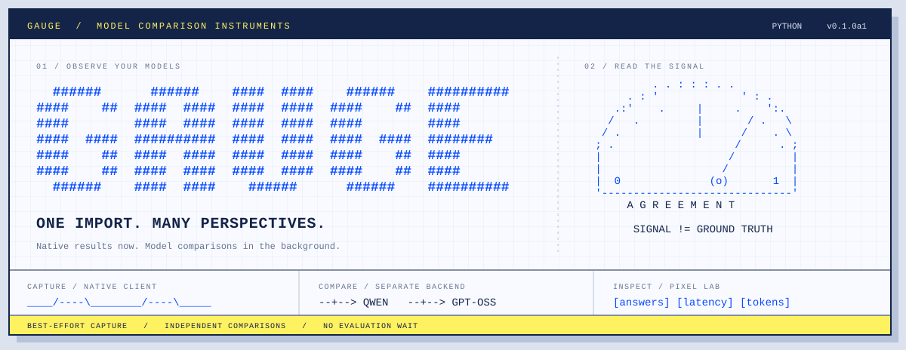

# Gauge

**Same call. A wider view.**

You already have a working OpenAI call. What would Qwen have answered?
How much time did the candidate spend reasoning? Where do the answers diverge?

Gauge captures the call and lets a separate backend investigate. Swap one import;
keep your application code. The original result returns without waiting for comparisons.

`Python 3.11+` · `v0.1.0a1 / pre-alpha` · `Typed` · `Standalone wheel`

[Quick start](#quick-start) · [How it works](#how-it-works) ·
[Dashboard](#dashboard) · [Experiments](#backend-api-synthetic-data-and-concurrent-comparisons) ·
[Terminal console](docs/console.md) · [Semantic judging](docs/judging.md) · [API scope](docs/api.md) · [Development](#development)

<details>
<summary>Terminal edition</summary>

```text
  ######      ######    ####  ####    ######    ##########
####    ##  ####  ####  ####  ####  ####    ##  ####
####        ####  ####  ####  ####  ####        ####
####  ####  ##########  ####  ####  ####  ####  ########
####    ##  ####  ####  ####  ####  ####    ##  ####
####    ##  ####  ####  ####  ####  ####    ##  ####
  ######    ####  ####    ######      ######    ##########

          . . : : : . .
      . : '             ' : .
    .:'    .     |     .    ':.
   /   .         |       / .   \
  / .            |      /    . \
 ; .                   /      . ;
 |                    /         |
 |                   /          |
 |  0              (o)       1  |
 '------------------------------'
      A G R E E M E N T

       SIGNAL != GROUND TRUTH
```

</details>

## Quick start

Install from the repository root, or install the wheel produced by the release build:

```sh
python -m pip install ./gauge
```

Change the import in your application:

```diff
-from openai import OpenAI, AsyncOpenAI
+from gauge.openai import OpenAI, AsyncOpenAI
```

Keep construction and client calls unchanged. Run your normal pytest command, then:

```sh
pytest
gauge requests
gauge inspect CALL_ID
gauge tui
gauge dashboard
```

No Gauge account, key, endpoint, manual run, or browser setup. Automatic pytest
integration groups the test execution and delivers pending captures at teardown.
The SDK persists captures on its bounded background worker. Terminal tooling starts
the separate local service when needed and reads the same `.gauge/captures.sqlite`.

The default distribution includes the client and terminal tooling. Optional extras
supply validation/development dependencies. Builds use PEP 517/621, a `src` layout,
and PEP 561 typing. The first release is built locally; no public-index publication
has been performed. See [release instructions](docs/releasing.md).

## How it works

```text
  YOUR APPLICATION                        SEPARATE BACKEND

  Gauge-wrapped OpenAI client
      |
      +-- native request --> OpenAI
      |   native result  <-- OpenAI
      |
      '-- bounded capture queue ----------> persisted requests
           best-effort delivery                  |
                                                 +--> candidate models
                                                 +--> comparisons / grades
                                                 '--> Pixel Lab dashboard
```

The wrapper preserves native results and exceptions and propagates capture to
`copy()` / `with_options()`. A generated `call_id` links each captured request and
response to its candidate results. Comparisons, generation, and grading execute in
a separate backend process with independent clients and provider credentials.
No backend acknowledgement or evaluation is awaited by the application.

| Capability | What you can inspect |
| --- | --- |
| Drop-in capture | Responses and Chat Completions; sync and async clients |
| Candidate comparisons | Original and candidate answers, exact agreement, failures, and skipped jobs |
| Token accounting | Reasoning, final-answer, non-reasoning, and unreported usage |
| Pixel Lab dashboard | Model tables, histograms, response pairs, request details, and recorded timing |
| Synthetic experiments | Shared cases, concurrent model calls, JSON reports, and standalone HTML |

A reference answer is an inference, **not ground truth**. Agreement measures whether
outputs match; it does not establish accuracy. Automatic evaluator creation remains
planned work.

## Terminal console

A Pixel Lab terminal workspace for live queues, saved runs, model comparisons,
output inspection, judging, export, and previewed cleanup:

```sh
gauge tui
```

From this checkout, use `uv sync --project gauge --all-extras` and
`gauge/.venv/bin/gauge tui`. See the [terminal guide](docs/console.md) for keys,
JSON commands, and backup behavior when clearing results.

## Dashboard

The backend serves the Pixel Lab dashboard and persists captures, comparison
results, and saved runs in SQLite. Model summaries lead the view; inspect a response
pair for its full request, output, and timing. Filter by model, status, or output
text, and explore latency and token distributions.

For local service setup and evaluation configuration, see the
[backend dashboard guide](dashboard/README.md). The packaged backend can run with
`python -m gauge.backend`; installed service management uses `gauge backend`. This package does not deploy a hosted service.

Preview a standalone report with synthetic data and no provider calls:

```sh
python -m gauge demo --output gauge-comparison.html
open gauge-comparison.html
```

Built distributions bundle the dashboard and Pixel Lab assets. An installed wheel
needs no sibling checkout or JavaScript build. Source checkout builds read the
shared assets from the repository's `pixel-lab/` directory; source distributions
include those assets.

## Capture and delivery

<details>
<summary>Capture limits, delivery behavior, and SDK compatibility</summary>

Capture observes the SDK's already-buffered JSON HTTP bodies for Responses and
Chat Completions POSTs, including `parse()` and cached raw-response helpers. It
retains immutable bytes, never parsed application objects, and never invokes
application serializers. It does not read stream bodies. Streaming captures are
explicitly ineligible for comparison. Full JSON bodies are captured; authorization
and transport headers are excluded. Prompts, outputs, and body metadata can still
contain application data.

Each body is capped at 64 KiB before Gauge retains it. Pending capture and local
history each have a 100-event / 4 MiB budget, plus one bounded in-flight event.
The queue uses a nonblocking lock attempt: contention, count limits, and byte
limits drop captures. Setup failure rolls back instrumentation and leaves the
native client usable. There is still small bookkeeping and shared-process CPU
cost; this is not a zero-overhead or hard real-time guarantee.

Captures persist locally by default. The automatic pytest plugin flushes pending
captures at teardown with a five-second budget; application code needs no flush or
shutdown calls. Short-lived applications outside pytest retain best-effort delivery.
Queue contention, limits, abrupt process exit, or storage failure can lose captures;
pytest writes delivery diagnostics under `.gauge/diagnostics`, exposed by `gauge status`.

To connect a project to an internal shared backend, use `gauge connect URL`.
For explicit direct delivery, configure `GAUGE_ENDPOINT` and `GAUGE_PROJECT_ID`
in the environment. Gauge does not use authentication tokens. The independent
export client never uses the provider client or its connection pool. It has bounded
retries/timeouts and a circuit breaker and never waits for an evaluation.

Set `GAUGE_ENABLED=0` to disable capture. `GAUGE_STORAGE=memory` selects temporary
in-memory diagnostics instead of local persistence. Configure delivery before client
construction; running workers retain their configuration.

Forked children discard inherited Gauge locks/queues and drop captures until a
client is constructed or wrapped there; native calls continue. Client setup also
restarts a dead worker. There is no background-thread restart on a serving call.
The SDK integration is tested against **OpenAI 3.29.x**, with both HTTPX and HTTPX2.
The dependency range is narrowed accordingly; an unsupported installed SDK falls
back to native behavior without capture. Full stream lifecycle capture and
Portkey's own SDK remain deferred.

See the [backend ingestion contract](docs/ingestion.md) for the versioned envelope,
idempotent inbox, eligibility checks, and receiver responsibilities. The included
local backend supports bounded comparison tests. The synthetic experiment runner
is a separate backend API; it is not an automatic production replay pipeline.

</details>

## Backend API: synthetic data and concurrent comparisons

The following configuration belongs in Gauge's backend, not in adopting applications:

```python
from gauge import Experiment, OpenAITarget, generate_cases

reference = OpenAITarget(
    name="reference",
    client=openai_client,
    model="gpt-5.6-terra",
    api="responses",
)
qwen = OpenAITarget(
    name="qwen",
    client=fireworks_client,
    model="accounts/fireworks/models/qwen3p8-max",
    api="chat.completions",
)

gpt_oss = OpenAITarget(
    name="gpt-oss",
    client=fireworks_client,
    model="accounts/fireworks/models/gpt-oss-120b",
    api="chat.completions",
)

cases = await generate_cases(
    generator=reference,
    task="Classify retail products as grocery, household, or other.",
    count=20,
)
report = await Experiment(
    instructions="Return exactly one label: grocery, household, or other.",
    reference=reference,
    candidates=[qwen, gpt_oss],
    max_concurrency=8,
).run(cases)

print(report.summary())
```

Generation happens once. The same inputs are then dispatched independently to
reference and candidate models with bounded concurrency. Neither receives the
other's answer. A failed or incomplete reference response is not treated as a
label or counted as candidate disagreement. Reports retain native payloads,
model configuration, case provenance, usage, latency, and separate assessments.
Model adapters never execute tools.

Run the offline example without keys or network:

```sh
python gauge/examples/offline.py
```

The provider example makes paid requests only when explicitly run. It reads
`OPENAI_API_KEY` and `FIREWORKS_API_KEY`. By default it compares Terra against
`accounts/fireworks/models/qwen3p8-max`, `accounts/fireworks/models/gpt-oss-120b`,
and `accounts/fireworks/models/deepseek-v4p1-flash`.
`GAUGE_REFERENCE_MODEL` overrides `gpt-5.6-terra`; comma-separated `FIREWORKS_MODELS`
replaces the candidate list (duplicates are removed).

```sh
python gauge/examples/openai_fireworks.py
```

The configured clients are caller-owned and closed by the example. It disables
SDK retries so call bounds match attempts, limits output tokens, and writes a
local JSON report and a standalone HTML comparison table. Each candidate is probed
before synthetic generation. Unavailable candidates are skipped and recorded in
the report; if all fail, generation/reference calls do not start. With all three default
candidates available, 20 cases make 84 logical calls including probes and generation.
It prints
per-target error/status counts and the report path, and exits unsuccessfully if
no comparisons were scored. `firectl list models` includes catalog models that may
require on-demand deployment; it does not guarantee serverless availability.

## HTML comparisons

Every live example run writes `gauge-report-<run-id>.html` beside the JSON report.
Open the HTML file in a browser: it needs no server, keys, or external assets.
The table includes every model's answer, agreement, latency, thought/answer tokens,
incomplete calls, search, disagreement filters, and expandable usage details.

Render an existing report without making model calls:

```sh
uv run --project gauge python -m gauge report gauge-report-<run-id>.json
```

Preview the design with clearly labeled illustrative data:

```sh
uv run --project gauge python -m gauge demo --output out/gauge-comparison.html
open out/gauge-comparison.html
```

Backend code can call `report.to_html()` and reload JSON with
`Report.from_dict(data)`. HTML generation belongs in the reporting job, outside the
serving path. Reports contain the evaluation inputs and outputs.

## Grading

`ExactMatch` reports literal **baseline agreement**, never accuracy. An optional
`Grader` adds an independent `assessment` without overwriting agreement or model
outputs. It can decide either answer is wrong, both are wrong, or evidence is
insufficient. Automatic evaluator creation remains a future backend feature;
its public API will be defined alongside an implementation.

Synthetic results are exploratory. A shared generator/reference can introduce
bias, and agreement between two models can preserve the same mistake. Later
evaluator validation needs independent cases and trustworthy labels or review.

See [the API scope](docs/api.md) for contracts and implementation boundaries.

## Token accounting

`output.token_usage` separates provider-reported `reasoning_tokens`,
`final_answer_tokens`, and `total_output_tokens`. `Report.token_summary()` aggregates
them by target; the example prints these counters and reports serialize both the
normalized breakdown and unchanged native `usage`.

Missing counters stay `null`, not zero. Final-answer counts use explicit provider
text counters for text-only outputs (or zero for a known empty answer channel).
When only total and reasoning counts are available, Gauge reports their difference
as `non_reasoning_output_tokens`, not exact answer tokens: that remainder may
include invisible formatting. Where all three are known, any residual is labeled
`unattributed_output_tokens`. Each call records how its counts were obtained.

Incomplete calls still contribute their token usage. Aggregate totals are `null`
when coverage is incomplete, with `known_totals` and `known_calls` showing the
available subtotal/coverage. These counts cover experiment calls, not dataset
generation or the example's preflight. No reasoning settings are changed.

## Public-data validation

See [the validation guide](docs/validation.md) for pinned BANKING77, MultiWOZ 2.2,
and SQuAD 2.0 fixtures, four client protocols, independent gold scoring, and
50-call smoke / 1,000-call full profiles. Validation lives in its own package;
dataset preparation, replay, scoring, and orchestration are separate modules.

Install with `python -m pip install './gauge[validation]'` and run
`python -m gauge.validation --help`.

## Development

```sh
uv sync --project gauge --extra dev
uv run --project gauge --extra dev pytest gauge/tests
uv run --project gauge --extra dev ruff check gauge
uv run --project gauge --extra dev ruff format --check gauge
uv run --project gauge --extra dev mypy gauge/src/gauge
uv build gauge
```

Tests use fake targets and HTTPX mock transports; they do not call model services.
